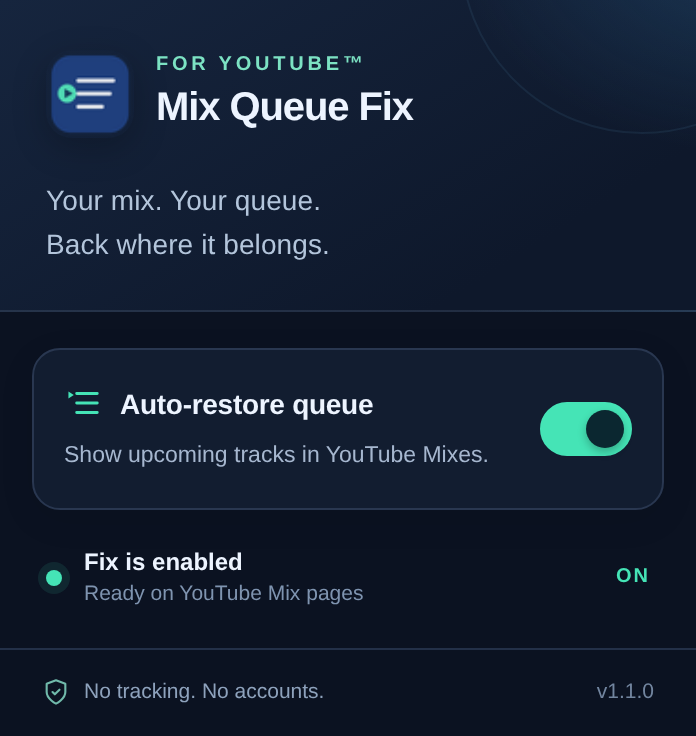

<!--
  +----------------------------------------------------------------+
  |                                                                |
  |     __  __    ___    _____                                     |
  |    |  \/  |  / _ \  |  ___|                                    |
  |    | |\/| | | | | | | |_                                       |
  |    | |  | | | |_| | |  _|                                      |
  |    |_|  |_|  \__\_\ |_|                                        |
  |                                                                |
  |    M I X   Q U E U E   F I X                                   |
  |    ~~~~~~~~~~~~~~~~~~~~~~~~~                                   |
  |                                                                |
  |    [ SYS: MQF-01 ]       [ MODE: QUEUE RESTORE ]               |
  |    [ EST: 2026  ]       [ SIGNAL: ACTIVE     ]                 |
  |                                                                |
  |    "The queue was never gone. Just hidden."                    |
  |                                                                |
  +----------------------------------------------------------------+
   FILE    : README.md
   MODULE  : PROJECT OVERVIEW
   VERSION : 1.1.0
   LICENSE : MIT
   -----------------------------------------------------------------
-->

  

# Mix Queue Fix

A lightweight extension that restores the hidden track queue on YouTube Mix pages.

## Features

- Restores the queue automatically when opening a Mix.
- Handles navigation between videos without reloading the page.
- ON/OFF control with a saved preference.
- Runs on YouTube only; no accounts, analytics or external requests.

## Install

1. Download and extract the extension files.
2. Open `edge://extensions`, `chrome://extensions` or `brave://extensions`.
3. Turn on **Developer mode**.
4. Choose **Load unpacked** and select the extracted folder containing `manifest.json`.
5. Open a YouTube Mix. Use the extension icon to enable or disable the fix.

## Preview

  

## How it works

When YouTube hides the Mix playlist, the extension removes the `hidden` attribute from the queue element. It also handles in-page navigation and subsequent layout updates. The switch state is stored locally.

## Tests

Run `node --test tests/smoke.test.cjs` with Node.js 18 or newer.

## Compatibility

Confirmed working in Microsoft Edge. Designed for Chromium-based browsers, including Chrome and Brave.

## Version

1.1.0
